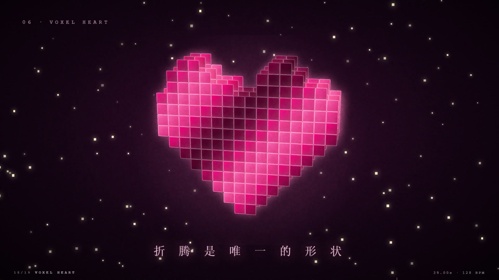

# 个人博客宣传片 · Retro Desktop Promo

一个用 **Remotion + React + TypeScript** 逐帧写出来的博客宣传片。
30 → 45 秒、128 BPM、19 个镜头，画面里没有一帧是剪辑软件里拖出来的，全部是代码。

> 站点：https://060929.xyz ｜ 仓库：[retro-desktop-blog](https://github.com/qiyuechen0929/retro-desktop-blog)



## 成片

▶ **[在线观看](https://qiyuechen0929.github.io/retro-desktop-blog/promo/)** ｜ 📥 **[下载原片](../docs/promo/blog-promo-1080p60.mp4)**（1920×1080 / 60fps / 45s / H.264 + AAC / 76 MB）

## 分镜表

| # | 段落 | 帧区 | 内容 |
| --- | --- | --- | --- |
| 01 | POWER ON | 0–112 | CRT 通电、扫描线亮起、自检文本 |
| 02 | POST | 112–225 | `SYSTEM READY` → `KERNEL PANIC: TOO MUCH 折腾` → 像素爱心聚合 |
| 03 | IDENTITY | 225–337 | 主标题 `ChenQiyue 的博客` |
| 04 | DESKTOP | 337–450 | 3D 悬浮显示器 + 小组件 |
| 05 | SKINS | 450–562 | 四套主题每拍轮换 + RGB 撕裂 |
| 06 | DIVE IN | 562–675 | 一头扎进首页，速度线俯冲 |
| 07 | ARTICLES | 675–787 | 文章窗口逐拍砸向镜头 |
| 08 | READING | 787–900 | 文章页滚动 + 阅读进度条 |
| 09 | GALLERY | 900–1012 | 六面截图 3D 立方体 |
| 10 | NUMBERS | 1012–1125 | 04 篇文章 / 04 套主题 / 01 个桌面 / ∞ 折腾 |
| 11 | FOUR WORLDS | 1125–1237 | 四色分屏合并成一句 |
| 12 | BREATHE | 1237–1350 | 留白静场 + riser，手打标语 |
| 13 | IMPACT | 1350–1462 | 落拍重击：巨型 logo 砸屏 |
| 14 | 060929.XYZ | 1462–1575 | Win98 浏览器敲地址 → 海面页面加载 |
| 15 | ORBIT | 1575–1687 | 四套主题环绕像素爱心 |
| 16 | SHATTER | 1687–1800 | 碎屏换肤：玻璃裂开，碎片飞散换主题 |
| 17 | PLAY | 1800–2137 | 可玩桌面：双击开窗、开始菜单、连点切换四套皮肤 |
| 18 | VOXEL HEART | 2137–2362 | 387 个体素方块聚合成心形 |
| 19 | THE END | 2362–2700 | 关标签页 → 塌缩成点 → 心跳 + 下篇文章见 |

## 技术要点

- **时间轴即节拍**：`BPM = 128`，一拍 28.125 帧，一小节 112.5 帧，所有切点落在小节线上。
- **震动与爆闪**：`src/Promo.tsx` 在每个小节重拍做 8px 随机位移 + 2 帧白闪。
- **章节 HUD**：底部进度条 + 刻度 + 当前章节名，随片播放。
- **真实素材**：用 CDP 脚本抓站点的 2× 截图（`tools/capture.mjs`），不用假模版。
- **音乐是代码合成的**：`tools/music.mjs` 生成 128 BPM、8 小节和弦循环（Am–F–C–G–Am–F–G–Em）的电子配乐，含 kick / clap / hat / bass / arp / pad / riser / impact / crash、延迟、伪混响、侧链与母带限幅。零版权风险。

## 目录

```
src/
  timeline.ts        时间轴、场景表、四套主题色板、文案常量
  Promo.tsx          组合根：场景编排 + 重拍震动 + 章节 HUD
  theme.tsx          字体与填充
  components.tsx     WinCard / PixelHeart / 光标 / 标签等图元
  fx/Background.tsx  流体背景 / 网格 / 星野
  fx/Overlay.tsx     颗粒 / 扫描线 / 暗角 / RGB 分离 / 切片故障 / 扫光
  scenes/S01..S20    19 个镜头，一个文件一个镜头
tools/
  capture.mjs        抓站点截图（CDP）
  music.mjs          合成配乐
public/
  shots/             站点 2× 截图
  fonts/             Orbitron / Audiowide / Noto Sans SC
  audio/track.wav    合成配乐
媒体文件在仓库根的 docs/promo/（在线播放页 + 成片 + 海报）
```

## 本地渲染

```bash
npm install
node tools/music.mjs          # 重新合成配乐（可选）
npx remotion studio           # 可视化时间轴
npx remotion render src/index.ts Promo out/promo.mp4
```

> 字体放在 `public/fonts/`（Orbitron、Audiowide、Noto Sans SC）。
> Windows 上 `remotion.config.ts` 指定了本机 Chrome 路径，可按需修改。

## License

代码 MIT。字体归各自作者所有。
